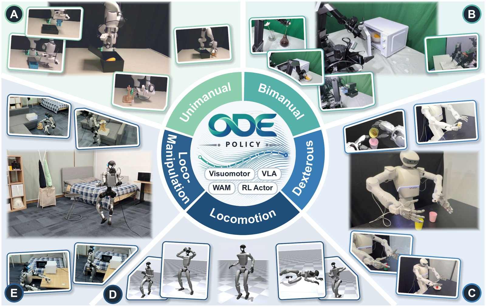
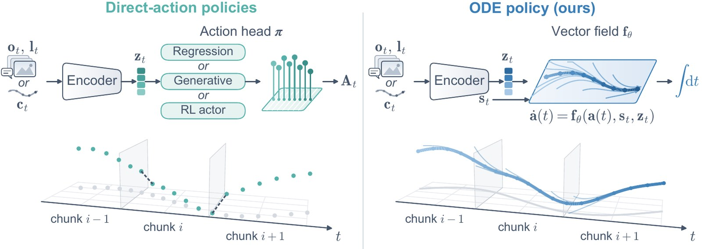

<div align="center">


# ODE Policy: Robot Learning via Action Dynamics, Not Actions

*Natura non facit saltus. Actions should not jump either.*

[](https://arxiv.org/abs/2611.01729) [](https://arxiv.org/pdf/2611.01729) [](https://ntumars.github.io/ODE/) [](https://ntumars.github.io/ODE/) [](LICENSE)

</div>

> [ODE Policy: Robot Learning via Action Dynamics, Not Actions](https://arxiv.org/abs/2611.01729) \
> [Jindou Jia](https://jiajindou.github.io/)<sup>\*‡</sup>, [Jingliang Li](https://jingliangli.com/)<sup>\*</sup>, [Kuangji Zuo](https://kuangjizuo.com/)<sup>\*</sup>, [Tuo An](https://morpheus-an.github.io/)<sup>\*</sup>, Yuxuan Hu, [Mengfei Zhao](https://murphyzhao.com/), Bofan Lyu, [Jiaqi Bai](https://b1ue-jay.github.io/homepage/), Daoyuan Zhu, Hengyu Dai, Junpeng Zhang, [Jianfei Yang](https://marsyang.site/)<sup>†</sup> \
> MARS Lab, Nanyang Technological University \
> <sup>\*</sup>Equal contribution &nbsp; <sup>‡</sup>Project lead &nbsp; <sup>†</sup>Corresponding author

<p align="center">
  
</p>

## 📰 News

- **[2026-11-09]** ⚡ **The ODE policy now defaults to the *Euler* solver**, which learns about as well as RK4 and
  generates a chunk of 8 actions in 5.7 ms on LIBERO. Add `policy_config.solver=rk4` to reproduce the paper's runs exactly.
- **[2026-11-03]** 📄 **The paper is on arXiv:** [2611.01729](https://arxiv.org/abs/2611.01729).
- **[2026-10-28]** 🌿 **Code released:** ODE policy, ten imitation-learning baselines, LIBERO and LIBERO-plus,
  the 2D multimodal navigation task, and branches for the Galaxea R1 Lite, the π0.5 VLA and SuperMimic RL.
  See [Branches](#-branches).

## 🌿 Branches

> [!IMPORTANT]
> **`main` holds the ODE policy, the baselines and the simulation benchmarks.** The real-robot, VLA and RL code lives
> on its own branch, each self-contained with its own setup and usage guide.

| Branch | Setting | Contents | Status |
| --- | --- | --- | --- |
| [`main`](https://github.com/NTUMARS/ODE-POLICY/tree/main) | 🖥️ Sim | ODE policy and the imitation-learning baselines of the paper, LIBERO and LIBERO-plus training and evaluation, the 2D multimodal navigation task. | ✅ available |
| [`real-r1lite`](https://github.com/NTUMARS/ODE-POLICY/tree/real-r1lite) | 🦾 Real | Galaxea R1 Lite, two arms in joint space: data conversion, training and deployment. | ✅ available |
| [`vla-pi05`](https://github.com/NTUMARS/ODE-POLICY/tree/vla-pi05) | 🧠 VLA | ODE action head for the π0.5 VLA (openpi), replacing its flow-matching action expert. | ✅ available |
| [`rl-supermimic`](https://github.com/NTUMARS/ODE-POLICY/tree/rl-supermimic) | 🏃 RL | ODE policy as the actor of SuperMimic (world-model RL, Unitree G1 whole-body motion tracking on LAFAN1), with the PPO baseline. | ✅ available |

---

**ODE policy** learns how the action changes, not the action itself. A direct-action policy predicts each action chunk
independently, so the motion jumps where chunks meet. ODE policy replaces only the action head: a neural ODE learns
the vector field of the action over the robot's physical time, and every action is integrated from the previous one.

- 🌊 **Continuous by construction.** Each chunk continues from the end of the previous one, so the executed motion
  has no jumps, and each action can be sent as soon as it is integrated.
- 📈 **Learns within one epoch.** Usable after a single pass over the data.
- ⚡ **Fast and light.** A small vector field integrated in a few steps, as fast as single-pass policies.
- 🔀 **Multi-modal.** A lightweight diversity head randomizes the direction of the field at the start of a chunk.
- 🤖 **One head, many models.** A visuomotor policy, the action head of VLAs and world action models, or an RL actor.

## 📊 Results

Against 14 baselines, in simulation and on four real robots:

- 📈 **Learning efficiency.** On LIBERO, **79.2%** after one epoch, **5.9×** flow matching (FM-DiT). It matches
  FM-DiT with less than half of the demonstrations, and with 1.5M parameters beats the 48M FM-DiT.
- 🧠 **At scale.** As a randomly initialized head of π0.5 with about 3% of the parameters of its action expert,
  **96.0%** after one epoch against 75.5%. In ImageWAM, **82.6%** against 24.6% for the original head.
- ⚡ **Execution.** **5.7 ms** per chunk of 8 actions, **10.8×** faster than FM-DiT, with the lowest end-effector jerk.
- 🌐 **Generalization and multi-modality.** After one epoch, **5.4×** the zero-shot success of flow matching on
  LIBERO-plus and **3.9×** its mode balance on a four-route navigation task.
- 🦾 **Real robots.** Highest success rate on all **15** tasks across single-arm, dual-arm, dexterous-hand and
  humanoid robots, and mostly smoother than the human demonstrations.
- 🏃 **Reinforcement learning.** As the actor of SuperMimic, a **30%** higher evaluation return after 0.4 hours and
  still ahead after 3 hours (0.885 against 0.845).

## 🚀 Getting started

| I want to... | Start here |
| --- | --- |
| Check the installation in minutes | [Quick start: 2D navigation](#-quick-start-2d-navigation-minutes) |
| Train and evaluate on LIBERO | [LIBERO](#-libero) |
| Reproduce the paper's simulation experiments | [docs/REPRODUCE.md](docs/REPRODUCE.md) |
| Run ODE policy on a Galaxea R1 Lite | [`real-r1lite`](https://github.com/NTUMARS/ODE-POLICY/tree/real-r1lite) |
| Put an ODE head on the π0.5 VLA | [`vla-pi05`](https://github.com/NTUMARS/ODE-POLICY/tree/vla-pi05) |
| Use ODE policy as an RL actor | [`rl-supermimic`](https://github.com/NTUMARS/ODE-POLICY/tree/rl-supermimic) |
| Bring ODE policy to my own robot or dataset | [docs/PORTING.md](docs/PORTING.md) |
| Read what worked and what did not | [docs/METHOD_NOTES.md](docs/METHOD_NOTES.md) |

## 🧠 How ODE policy works

<p align="center">
  
</p>

The policy learns a velocity field

```
da/dt = f(c, s, a)
```

- **a**: the action state, i.e. the reference the controller tracks. On LIBERO this is the end-effector pose the
  controller is aiming at (the *virtual target*, see [docs/METHOD_NOTES.md](docs/METHOD_NOTES.md)).
- **c**: the observation condition (8 frames of images and the language instruction).
- **s**: proprioception, given to the vector field only.

1. **Decide.** Every H = 8 control steps, read the observation once and encode the condition `c`. `c` and `s` stay
   fixed for the chunk.
2. **Integrate.** Integrate the field with *Euler* for 8 steps (one field call per step), starting from the last
   integrated action rather than the measured pose, so consecutive chunks join without a jump. The paper used RK4.
   RK4, RK2 and *Euler* learn about equally well.
3. **Track.** The robot's controller tracks the 8 integrated references.

**Training.** Integrate the field from the demonstrated action for 8 steps and match the whole path to the
demonstration (MSE), backpropagating through the solver. No velocity labels, no differencing. A contractive start
perturbation (start shifted by δ, target offset shrinking by ρ^k) teaches the field to pull drift back to the
demonstration.

**Optional diversity head.** A small head reads the field's (detached) features at the chunk start and samples a
direction ε from a learned mixture, added to the velocity with a learned per-step rate. The field and its gradients
are untouched, and with ε = 0 the policy is exactly the plain ODE.

### Methods on `main`

`<policy>` is the name used by the scripts below.

| Policy | Name | Action head |
| --- | --- | --- |
| **ODE-MLP** (ours) | `ode` | velocity field = FiLM residual MLP, integrated with *Euler* |
| **ODE-DiT** (ours) | `ode_dit` | velocity field = adaLN DiT blocks, integrated with *Euler* |
| FM-DiT | `fm_dit` | conditional flow matching, DiT |
| FM-UNet | `fm_unet` | conditional flow matching, 1D UNet |
| A2A-DiT | `a2a_dit` | flow from the action history, DiT |
| A2A | `a2a` | flow from the action history, MLP |
| DDPM-DiT | `ddpm_dit` | diffusion, DiT |
| DDPM-UNet | `ddpm_unet` | diffusion, 1D UNet (Diffusion Policy) |
| DDIM-UNet | `ddim_unet` | DDIM sampling, 1D UNet |
| MARS | `mars` | flow matching with a learned history / noise router |
| ACT | `act` | CVAE + transformer decoder |

All methods share the same observation encoder (ResNet18 with GroupNorm, randomly initialised, 8 frames and a frozen
CLIP embedding of the instruction) and, on LIBERO, about 24M parameters outside the encoder.

## 🛠️ Installation

Linux with an NVIDIA GPU and conda. One script sets up everything, with the exact versions the paper's results were
produced with (Python 3.10, PyTorch 2.5.1 + CUDA 12.1, robosuite 1.4.1, MuJoCo 2.3.5, LIBERO at a pinned commit):

```bash
git clone https://github.com/NTUMARS/ODE-POLICY.git && cd ODE-POLICY
bash scripts/setup_env.sh          # creates the conda env "ode_policy"
conda activate ode_policy
```

Options (environment variables): `ENV_NAME`, `ENV_PREFIX` (env at a path), `TORCH_CUDA` (`cu118` / `cu121` / `cpu`).
LIBERO's path config is written to `third_party/libero_config/` and selected through `LIBERO_CONFIG_PATH`, set for
this conda env only (`~/.libero` is not touched). Rendering uses EGL (`MUJOCO_GL=egl`, set by the scripts).

## 🧭 Quick start: 2D navigation (minutes)

A circle agent passes one of four gaps in a wall, and all four routes are demonstrated equally often. A quick check
that the installation works, and the multimodality experiment of the paper:

```bash
bash scripts/run_nav2d.sh ode        # also: fm_dit | a2a_dit | mars;  optional 2nd arg: seed
```

It generates 200 demonstrations, trains for 20 epochs and evaluates 100 rollouts at epochs 1 / 3 / 5 / 10 / 20:
success rate, how often each route is taken, and the mode balance γ (1 = all four routes equally often). Results and
trajectory plots are written to `il_outputs/ode_nav2d_s42/nav2d/eval/`.

## 🧪 LIBERO

**Data** (≈34 GB download):

```bash
bash scripts/prepare_libero_data.sh
```

This downloads the official demonstrations, converts each suite to zarr with a CLIP embedding of every instruction,
merges the four suites into one training set (`data_policy/libero_4suite_50demo.zarr`, 40 tasks, 2000 demonstrations)
and derives the ODE policy's virtual-target version (`data_policy/libero_4suite_50demo_ode_vt.zarr`, images are
symlinked, so it costs megabytes).

**Train** one model on all four suites (100-epoch cosine schedule, batch 32, seed 42):

```bash
bash scripts/train_libero.sh ode
bash scripts/train_libero.sh fm_dit            # any policy name from the table above
bash scripts/train_libero.sh ode libero_4suite train_config.training_params.checkpoint_epochs=[1,10,100]
```

Checkpoints are written to `il_outputs/<policy>/libero_4suite/checkpoints/<epoch>.ckpt`. The configuration in
[`ode.yaml`](ode_policy/configs/policy_config/ode.yaml) is the one used in the paper except the solver, which defaults
to *Euler*. Add `policy_config.solver=rk4` to reproduce the paper's runs exactly.

**Evaluate** on the four suites (10 tasks × 20 episodes each, LIBERO's fixed initial states):

```bash
bash scripts/eval_libero.sh il_outputs/ode/libero_4suite/checkpoints/100.ckpt
bash scripts/eval_libero.sh il_outputs/ode/libero_4suite/checkpoints/100.ckpt libero_object
```

The ODE evaluator defaults to the paper's protocol (8 steps per inference, carried execution, tracker gain 1, centre
of the diversity head's mixture component). Every evaluation also records execution quality: completion time,
end-effector jerk, command smoothness inside and across chunks, and inference time (`__exec__` in the result json).

> [!TIP]
> To reproduce the paper's experiments (data efficiency, network size, chunk length, integrator, LIBERO-plus zero-shot
> generalization, inference speed), see [docs/REPRODUCE.md](docs/REPRODUCE.md).

## 🦾 Bring ODE policy to your robot

The one step that matters is choosing the action state `a` so that the controller reproduces the demonstration from
it. [docs/PORTING.md](docs/PORTING.md) covers:

- **The virtual target** for delta controllers, and absolute and joint-space control.
- **The pose representation** of the action state.
- **The settings that must stay aligned** between training and execution.

[docs/METHOD_NOTES.md](docs/METHOD_NOTES.md) collects what we learned along the way, including what did not work.

## 📁 Repository layout

<details>
<summary>Click to expand</summary>

```
ode_policy/
├── policies/ode/ode_image_policy.py   # the ODE policy: vector fields, integration, loss, diversity head
├── policies/{fm,a2a,dp,mars,act}/     # baselines
├── configs/policy_config/             # one yaml per policy (ode.yaml = the paper's configuration)
├── libero/                            # LIBERO: data conversion, env wrapper, training runner, evaluators
│   ├── build_ode_zarr.py              #   demonstrations -> virtual-target poses for the ODE policy
│   ├── pose.py                        #   pose representation and the pose -> OSC command tracker
│   ├── eval_ode_policy.py             #   ODE evaluator
│   ├── libero_eval_runner.py          #   evaluator for every other policy
│   └── libero_plus_eval_runner.py     #   LIBERO-plus zero-shot evaluation
├── nav2d/                             # 2D multimodal navigation task
├── datasets/ utils/ runners/          # zarr datasets, encoders, normalizers, checkpointing
└── train.py                           # Hydra training entry point
scripts/                               # setup, data, train, eval
docs/                                  # reproduction guide, porting guide, method notes
```

</details>

## 🙏 Acknowledgements

The training and policy infrastructure descends from [RoboVerse](https://github.com/RoboVerseOrg/RoboVerse) and
[Diffusion Policy](https://github.com/real-stanford/diffusion_policy). The ACT baseline builds on
[ACT](https://github.com/tonyzhaozh/act) (DETR). We thank the authors of
[LIBERO](https://github.com/Lifelong-Robot-Learning/LIBERO) and [LIBERO-plus](https://github.com/sylvestf/LIBERO-plus)
for the benchmarks and demonstrations.

## 📄 License

Apache License 2.0, see [LICENSE](LICENSE).

## 📝 Citation

If you find ODE policy useful, please cite:

```bibtex
@article{jia2026ode,
  title   = {{ODE} Policy: Robot Learning via Action Dynamics, Not Actions},
  author  = {Jia, Jindou and Li, Jingliang and Zuo, Kuangji and An, Tuo and Hu, Yuxuan and Zhao, Mengfei
             and Lyu, Bofan and Bai, Jiaqi and Zhu, Daoyuan and Dai, Hengyu and Zhang, Junpeng and Yang, Jianfei},
  journal = {arXiv preprint arXiv:2611.01729},
  year    = {2026}
}
```
